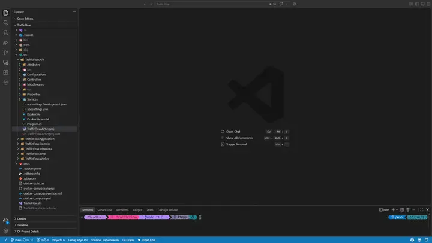
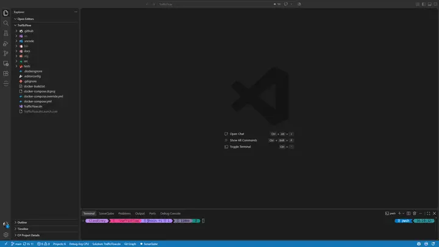

# NuGet Assistant

Manage NuGet packages graphically in VS Code. Search, install, update, and remove packages from .NET projects and solutions.

## How to Use

1. In the Explorer, right-click a `.csproj`, `.fsproj`, or `.vbproj` file.
2. Select **NuGet Assistant: Manage Project Packages**.



To manage packages across a solution, right-click an `.sln` or `.slnx` file and select **NuGet Assistant: Manage Solution Packages**.



You can also launch these commands from the Command Palette (`Ctrl+Shift+P`) by searching for **NuGet Assistant**.

## Features

- Search for packages by name from a specific source or across **All** configured sources.
- Choose the target project before applying package changes.
- Install a specific package version.
- Update or uninstall installed packages.
- Update multiple packages simultaneously.
- View package details, including descriptions, authors, licenses, dependencies, tags, and project links.
- View known vulnerabilities and related security advisories.
- Supports NuGet V2 and V3 feeds, including nuget.org, Azure Artifacts, GitHub Packages, GitLab, MyGet, JFrog Artifactory, Sonatype Nexus, ProGet, and other compatible private feeds.
- Works on Linux, macOS, and Windows.
- Fits naturally into your VS Code setup, adapting to light, dark, and high-contrast themes.
- Supports English, Brazilian Portuguese, and Simplified Chinese. By default, the extension follows the VS Code display language, with an option to choose a language explicitly in settings.

Package operations are executed through the `dotnet` CLI. Ensure that the .NET SDK is installed and available in your `PATH`.

## Extension Settings

Configure these options in your VS Code User or Workspace settings:

| Setting | Default | Description |
| --- | --- | --- |
| `nuget-assistant.language` | `auto` | Language used by NuGet Assistant. Options: `auto`, `en`, `pt-BR`, and `zh-CN`. `auto` follows the VS Code display language and falls back to English if it is unsupported. |
| `nuget-assistant.loggingLevel` | `None` | Output channel logging detail: `None` disables logging, `Information` logs routine activity, HTTP response status codes, and errors, `Error` logs errors only, and `Debug` logs routine activity and detailed HTTP requests and responses, including response bodies up to the configured limit. |
| `nuget-assistant.debugResponseBodyLimitKb` | `32` | Maximum response body size, in KiB, written to the output channel when `loggingLevel` is `Debug`. Range: `0`–`5120`; set to `0` to omit response bodies. |
| `nuget-assistant.allowInsecureHttpCredentials` | `false` | Allows NuGet source credentials to be sent over unencrypted HTTP connections. Enable only for trusted package sources and network environments. |

## Package Source Configuration

Package sources are loaded from the following locations, in order:

- User configuration file:
  - Windows: `%APPDATA%\NuGet\NuGet.Config`
  - macOS/Linux: `~/.nuget/NuGet/NuGet.Config`
- Additional configuration files:
  - Windows: `%APPDATA%\NuGet\config`
  - macOS/Linux: `~/.nuget/NuGet/config`
- `NuGet.Config` files located in the project directory and its parent directories.

Example configuration for public and private package sources:

```xml
<configuration>
  <packageSources>
    <add key="NuGet.org" value="https://api.nuget.org/v3/index.json" />
    <add key="Private" value="https://nuget.example.com/v3/index.json" />
    <add key="GitHub" value="https://nuget.pkg.github.com/NAMESPACE/index.json" />
  </packageSources>
</configuration>
```

### Credentials for Private Feeds

To enable package searches on private feeds, add `Username` and `ClearTextPassword` entries under `packageSourceCredentials`:

```xml
<packageSourceCredentials>
  <Private>
    <add key="Username" value="<YOUR-USERNAME>" />
    <add key="ClearTextPassword" value="<YOUR-PASSWORD>" />
  </Private>
  <GitHub>
    <add key="Username" value="<YOUR-GITHUB-USERNAME>" />
    <add key="ClearTextPassword" value="<YOUR-TOKEN>" />
  </GitHub>
</packageSourceCredentials>
```

> **Note:** Only `ClearTextPassword` is supported. Encrypted `Password` entries are ignored.

You can avoid storing credentials directly in the config file by referencing environment variables using NuGet's `%NAME%` syntax. NuGet resolves these variables on Windows, macOS, and Linux:

```xml
<packageSourceCredentials>
  <Private>
    <add key="Username" value="%YOUR_USERNAME%" />
    <add key="ClearTextPassword" value="%YOUR_PASSWORD%" />
  </Private>
</packageSourceCredentials>
```

If an environment variable is not defined, NuGet does not replace the placeholder and keeps the %NAME% value unchanged.

### Credentials over HTTP

By default, NuGet Assistant blocks HTTP requests that would send credentials defined in `packageSourceCredentials`. HTTPS requests are not affected, and HTTP requests that do not include credentials continue to work normally.

To allow credentials to be sent over HTTP, enable the following VS Code setting in your User or Workspace settings:

```json
{
  "nuget-assistant.allowInsecureHttpCredentials": true
}
```

**Warning**: HTTP traffic is not encrypted. When this setting is enabled, credentials may be exposed to anyone who can intercept or observe the network connection. Only enable this setting for trusted package sources and trusted network environments.
