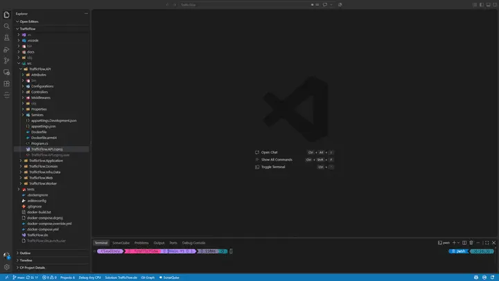
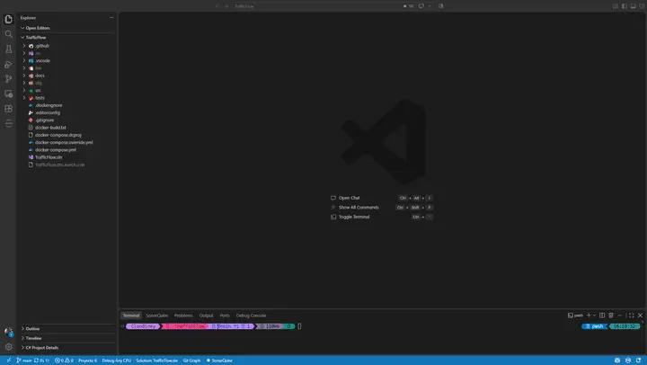

# NuGet Assistant

Manage NuGet packages directly within Visual Studio Code through a modern graphical interface. Search, install, update, and remove packages from .NET projects and solutions without leaving the editor.

## Highlights

- Search, install, update, and remove NuGet packages without leaving VS Code
- Manage packages across individual projects or entire solutions
- Support for public and private package feeds
- Built-in Central Package Management support
- Package vulnerability detection and security advisory links
- Cross-platform support: Windows, macOS, and Linux

## How to Use

### Manage Packages in a Project

1. In the Explorer, right-click a `.csproj`, `.fsproj`, or `.vbproj` file.
2. Select **NuGet Assistant: Manage Project Packages**.



### Manage Packages in a Solution

To manage packages across an entire solution, right-click an `.sln` or `.slnx` file and select **NuGet Assistant: Manage Solution Packages**.



### Command Palette

You can also access all NuGet Assistant commands from the Command Palette (`Ctrl+Shift+P`) by searching for "NuGet Assistant".

## Features

### Package Management

- Search for packages by name from a specific feed or across **all** configured sources.
- Install any available package version.
- Update or uninstall installed packages.
- Update multiple packages simultaneously.
- Select the target project before applying changes.
- Choose how package operations are performed:
  - Using the .NET CLI (`dotnet`)
  - By editing project files directly

### Package Information

- View package descriptions, authors, licenses, dependencies, tags, and project links.
- Review known vulnerabilities and related security advisories before installing or updating packages.

### Central Package Management

- Full support for **Central Package Management (CPM)**.
- Add, update, and remove package references managed through `Directory.Packages.props`.
- Automatically detect projects that use centrally managed package versions.

### Feed Support

Supports NuGet V2 and V3 feeds, including:

- NuGet.org
- Azure Artifacts
- GitHub Packages
- Other compatible private feeds

### VS Code Integration

- Available from both the Explorer context menu and the Command Palette.
- Works on Windows, macOS, and Linux.
- Adapts automatically to light, dark, and high-contrast themes.
- Supports English, Brazilian Portuguese, and Simplified Chinese.
- Follows the VS Code display language by default, with an option to override it in settings.

## Requirements

NuGet Assistant requires the .NET SDK to perform package operations.

Make sure a compatible SDK version is installed and available in your system `PATH`.

## Extension Settings

Configure these options in your VS Code User or Workspace settings:

| Setting | Default | Description |
|----------|----------|-------------|
| `nuget-assistant.language` | `auto` | Language used by NuGet Assistant. Options: `auto`, `en`, `pt-BR`, and `zh-CN`. When set to `auto`, the extension follows the VS Code display language and falls back to English when necessary. |
| `nuget-assistant.loggingLevel` | `None` | Controls output channel logging. `None` disables logging, `Error` logs errors only, `Information` logs routine activity, HTTP status codes, and errors, and `Debug` adds detailed HTTP requests and responses, including response bodies up to the configured limit. |
| `nuget-assistant.debugResponseBodyLimitKb` | `32` | Maximum response body size, in KiB, written to the output channel when `loggingLevel` is `Debug`. Range: `0`–`5120`. Set to `0` to omit response bodies entirely. |
| `nuget-assistant.allowInsecureHttpCredentials` | `false` | Allows NuGet source credentials to be sent over unencrypted HTTP connections. Enable only for trusted package sources and network environments. |
| `nuget-assistant.packageExecutionMode` | `projectFile` | Defines how package changes are applied: through the .NET CLI (`dotnet`) or by editing project files directly (`projectFile`). |
| `nuget-assistant.showTaskWindow` | `false` | Displays package operation progress in the VS Code Tasks window. |

## Package Source Configuration

NuGet Assistant loads package sources using the same configuration hierarchy as NuGet.

Sources are loaded from the following locations, in order:

### User Configuration

- Windows: `%APPDATA%\NuGet\NuGet.Config`
- macOS/Linux: `~/.nuget/NuGet/NuGet.Config`

### Additional Configuration Files

- Windows: `%APPDATA%\NuGet\config`
- macOS/Linux: `~/.nuget/NuGet/config`

### Project-Level Configuration

- `NuGet.Config` files located in the project directory and any parent directories.

### Example

The following configuration demonstrates how to register public and private package feeds:

```xml
<configuration>
  <packageSources>
    <add key="NuGet.org" value="https://api.nuget.org/v3/index.json" />
    <add key="Private" value="https://nuget.example.com/v3/index.json" />
    <add key="GitHub" value="https://nuget.pkg.github.com/NAMESPACE/index.json" />
  </packageSources>
</configuration>
```

## Credentials for Private Feeds

To enable package searches against authenticated feeds, specify credentials under `packageSourceCredentials`:

```xml
<packageSourceCredentials>
  <Private>
    <add key="Username" value="<YOUR-USERNAME>" />
    <add key="ClearTextPassword" value="<YOUR-PASSWORD>" />
  </Private>
  <GitHub>
    <add key="Username" value="<YOUR-GITHUB-USERNAME>" />
    <add key="ClearTextPassword" value="<YOUR-TOKEN>" />
  </GitHub>
</packageSourceCredentials>
```

> **Note**
> NuGet Assistant currently supports only the `ClearTextPassword` credential format. Encrypted `Password` entries are ignored.

### Using Environment Variables

To avoid storing credentials directly in configuration files, reference environment variables using NuGet's `%NAME%` syntax:

```xml
<packageSourceCredentials>
  <Private>
    <add key="Username" value="%YOUR_USERNAME%" />
    <add key="ClearTextPassword" value="%YOUR_PASSWORD%" />
  </Private>
</packageSourceCredentials>
```

NuGet resolves these variables on Windows, macOS, and Linux.

If an environment variable is not defined, NuGet leaves the placeholder unchanged rather than replacing it with an empty value.

## Credentials over HTTP

By default, NuGet Assistant blocks HTTP requests that would send credentials defined in `packageSourceCredentials`.

HTTPS requests are not affected, and HTTP requests that do not contain credentials continue to work normally.

To allow credentials to be sent over HTTP, enable the following setting:

```json
{
  "nuget-assistant.allowInsecureHttpCredentials": true
}
```

> **Warning**
> HTTP connections are not encrypted. Enabling `nuget-assistant.allowInsecureHttpCredentials` may expose credentials to anyone with access to the network traffic. Enable this option only for trusted package sources and trusted network environments.